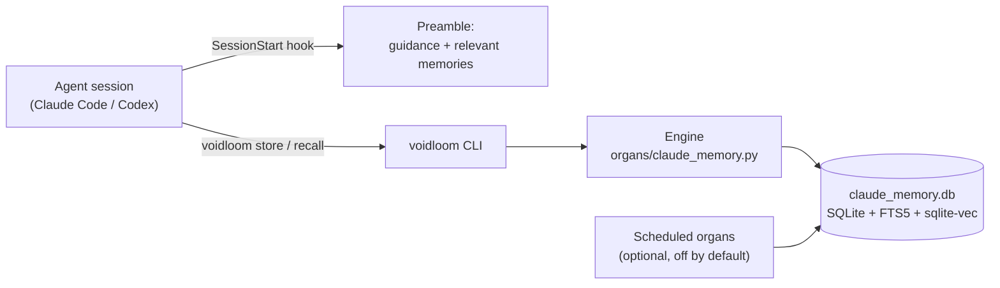

# Voidloom

**A living memory tapestry woven for AI agents.**

Voidloom gives an AI coding agent a memory that lasts between sessions. You (or
the agent) store what was learned — decisions, preferences, fixes, conventions —
and later recall it by meaning, not just by matching words. When a new session
starts in Claude Code or Codex, a hook hands the agent its relevant memories
before the first prompt. Everything runs on your own machine: a command-line
tool called `voidloom`, a session-start hook, and one SQLite file that is the
brain.

[](https://github.com/void-wright/voidloom/actions/workflows/ci.yml)
[](./LICENSE)

---

## Why Voidloom

- **Local-first and private.** The brain is one SQLite file in your home
  directory. Storing and recalling never leave your machine, there is no
  account and no telemetry, and Voidloom refuses to open a brain on a network
  or cloud-synced folder.
- **Recall by meaning.** Vector search and keyword search run side by side,
  their rankings are fused, and an optional reranker orders the result. A
  keyword-only fallback that needs nothing but Python is always there.
- **Starts competent.** A fresh brain is loaded with a seed pack of 82 memories
  that teach an agent how to use the brain itself.
- **Works with Claude Code and Codex.** A session-start hook injects context
  automatically; for tools without hooks, an instruction block in `AGENTS.md`
  / `CLAUDE.md` carries the same guidance.
- **Honest about the network.** The only network traffic is installing
  packages and models, plus the optional overnight jobs you choose to arm.
  [What touches the network](#what-touches-the-network) lists every case.
- **Maintains itself overnight — if you want it to.** Optional scheduled jobs
  consolidate memories, link related ones, look for gaps and contradictions,
  and propose improvements for you to approve. They are **off** until you turn
  them on.

---

## A 60-second taste

After [installing](#install), from any folder:

```bash
voidloom bootstrap        # what this machine has: OS, GPU, brain, models (loads nothing)

voidloom store --content "The deployment checklist lives in the ops runbook; always run the smoke test before tagging a release." \
  --category workflow_pattern --tags "release,checklist" --importance 0.8

voidloom recall --query "what should I do before I cut a release?" --top-k 5
```

The recall finds the stored memory even though the question shares almost no
words with it. That is semantic recall. On a keyword-only install, recall
matches words instead, so query with words that appear in the memory.

The first `store` or `recall` in a process loads the embedding model, which
takes a moment; `bootstrap` never does.

---

## Requirements

| You need | Notes |
|---|---|
| Linux (including WSL2) or macOS | Windows has its own installer, `install/install.ps1` (see below). |
| `bash`, `git`, Python 3.10 or newer | The keyword-only brain runs on Python's standard library alone. On a Mac, use a Miniforge Python — Apple's own `python3` cannot load SQLite extensions ([how](./docs/ONBOARDING_GUIDE.md#on-a-mac-and-on-any-machine-that-is-not-an-nvidia-pc)). |
| Disk for the semantic tier | The installer's own estimates: a Python environment of about **6 GB** on Linux with an NVIDIA GPU (the CUDA build of PyTorch) or about **1.5 GB** CPU-only, plus about **1.8 GB** of models downloaded once. pip's download cache adds a few GB more, which you may delete afterwards. |
| Disk for keyword-only (`--tier0-only`) | About 10 MB for the package; the brain starts at about 1 MB and grows with use. |
| Optional | Claude Code and/or Codex, for the session hook. A model account, only if you want the overnight jobs to think. |

### Which machines are proven

The installer picks the compute once, says which it chose and why, and checks
the chosen device against reference vectors before it embeds anything.

| Machine | Compute | Status |
|---|---|---|
| Linux + NVIDIA GPU | CUDA | **PROVEN** |
| Linux, CPU only | CPU | **PROVEN** |
| Apple Silicon Mac | MPS | **PROVEN** |
| Apple Silicon Mac on the CPU | CPU | **PROVEN** |
| Intel Mac (CPU) | CPU | **SUPPORTED-UNPROVEN** |
| Linux + AMD GPU | ROCm | **SUPPORTED-UNPROVEN** |
| Linux + Intel GPU | XPU | **SUPPORTED-UNPROVEN** |
| Windows | — | separate installer (`install/install.ps1`); not covered by these labels |

**PROVEN**: installed and run end to end on that hardware — by the test battery (Linux) or a real install and use, witnessed (Apple Silicon). **SUPPORTED-UNPROVEN**:
the code path exists, its decisions are tested with fakes and the PyTorch wheel
resolves for that platform, but it has not yet run on that chip. If a machine's
own device check fails, the installer moves it to the CPU, says so, and records
`FAILED-ON-THIS-MACHINE`.

---

## Install

### The plain path

```bash
git clone https://github.com/void-wright/voidloom.git
cd voidloom
bash install.sh
```

On a machine with no brain yet, this starts a new one (loaded with the seed pack).
To keep using a brain you already have, see `--attach-db` under
[Installer reference](#installer-reference).

Want to look first? Both of these change nothing:

```bash
bash install.sh --dry-run                    # print every step the install would take
bash install.sh --print-write-set            # list every path outside ~/.claude it may touch
```

### The questions it asks

Nothing is pre-selected; a blank answer is asked again unless noted.

1. **The overnight thinker** — asked before anything is written, on the first
   install and on any later one that has no recorded answer:

   > **Should your brain think while you sleep, and with which model?**
   >
   > a) Claude  
   > b) Codex  
   > c) Kimi  
   > d) Gemini (Google; runs through Google's Antigravity program)  
   > e) Not now — no model; keep the simple nightly routines  
   > f) Other (which model?)  
   >
   > The model you chat with can be a different one: this answer is only about the thinking your brain does on its own, overnight.

   *Why:* the optional overnight jobs need a model to think with, and which
   one — or none — is your decision. If unsure, answer **e**; you can change it
   later with `voidloom thinker set`. For a–d the installer walks you through
   giving the brain its **own** credential (never your everyday sign-in),
   proves it with a small test request, and only then records it. Gemini on
   Linux also needs **bubblewrap** (`sudo apt install bubblewrap`; the
   installer shows the command and never runs it). Step-by-step for each model:
   [`docs/OVERNIGHT_THINKER_SETUP.md`](./docs/OVERNIGHT_THINKER_SETUP.md).

2. **Approvals** — once a month the brain reviews itself and proposes
   improvements. *a) Automatic* (the default; a blank line chooses it): the
   brain approves its own monthly proposals and tells you at the start of each
   session what it decided. *b) Manual*: each proposal waits for you in
   `voidloom approvals --tui`.

3. **Which GPU** — asked only on a machine with two or more NVIDIA GPUs and
   nothing declared yet: *"Which card drives your monitor(s)?"* and *"Which
   card should the brain's background jobs use?"* A background model on the
   monitor's card can starve your desktop without any error, so the installer
   never guesses; choosing the monitor's card anyway needs its number typed a
   second time.

4. **The session hook** — at the very end: *"Wire the session-start hook now so
   your first session offers the Persona Forge? [Y/n]"*. Yes adds one entry to
   `~/.claude/settings.json` (backed up first).

The install ends with **MANDATORY NEXT STEP: open Claude Code in any folder and
type /persona-forge** — a short guided conversation in which you design the
agent's working persona. "Not now" is a fine answer; see
[`docs/PERSONA_FORGE.md`](./docs/PERSONA_FORGE.md).

### Installing on someone's behalf (scripts and AI agents)

With no terminal to ask, the installer refuses (exit code 2, nothing touched)
until the answers arrive as flags:

| Question | Flag |
|---|---|
| Overnight thinker | `--thinker claude\|codex\|kimi\|gemini\|off\|local` |
| May it run the model company's own installer, if that program is missing? | `--install-thinker-cli` (only on the person's yes) |
| Approvals | `--approvals auto\|manual` |
| Monitor card / jobs card | `--display-gpu <card\|none> --gpu <card>` |
| Session hook | `--wire-hooks` or `--no-wire-hooks` |

**An installing AI agent must put the thinker question to the person word for word,
wait for their answer, and pass it as `--thinker claude|codex|kimi|gemini|off|local`
— it must never choose the answer itself.** The same holds for the GPU and
approvals questions: ask, then pass the person's answers. A `CUDA_VISIBLE_DEVICES` set in the installing shell is not
an answer and is ignored.

### Keyword-only, other shapes, and Windows

- `--tier0-only` skips the semantic tier entirely: no Python environment, no
  model downloads, keyword recall only. You can add the semantic tier later by
  re-running the installer without it.
- `--force-cpu` keeps everything on the CPU even when a GPU is present.
- `--with-crons` also arms the scheduled jobs (see
  [Scheduled jobs](#scheduled-jobs)).
- Windows: `powershell -ExecutionPolicy Bypass -File install\install.ps1`
  (`-Tier0Only`, `-DryRun`). It mirrors the Linux/macOS installer but does not
  yet choose an accelerator.

Every flag: `bash install.sh --help`.

---

## What the installer puts on your machine

| Path | What it is | When |
|---|---|---|
| `~/.claude/memory/` | The code (engine, CLI, hooks, migrations, seed pack) and the brain itself, `claude_memory.db`, plus `INSTALL_RECORD` / `INSTALL_LOG` | always |
| `~/.claude/memory/venv/` | The semantic tier's Python environment | unless `--tier0-only` |
| `~/.local/bin/voidloom` | The `voidloom` command (a symlink) | always |
| `~/.voidloom/wizard-library-env` | Settings every scheduled job reads (PATH, brain location, embedding model, GPU choice), mode `0600`; your own lines outside its managed block are kept | always |
| `~/.voidloom/wizard-config.json` | The reranker decision and your approvals choice | always |
| `~/.claude/skills/persona-forge/`, `~/.claude/commands/persona-forge.md` | The Persona Forge and its `/persona-forge` command | after the install's self-check passes |
| `~/.claude/skills/memory-operator/` | Two blank outlines for writing a persona by hand | always |
| `~/.claude/settings.json` | One SessionStart hook entry, backed up first | only if you answer yes (or `--wire-hooks`) |
| `~/.voidloom/thinker/` | The overnight thinker's own credential, mode `700` | only if you choose a model that needs one |
| `~/.cache/huggingface/`, `~/.cache/pip/` | Downloaded models and pip's cache | semantic tier |
| `~/.config/systemd/user/wizard-library-*` (Linux) or `~/Library/LaunchAgents/voidloom.*.plist` (macOS) | Scheduled jobs | only with `--with-crons` |

On a GPU machine, PyTorch also leaves compile caches (`~/.nv`, `~/.triton`,
`/tmp/torchinductor_*`). The complete, per-step declaration — including what an
optional model-vendor installer may add — is
[`install/write_set.json`](./install/write_set.json);
`bash install.sh --print-write-set` prints it resolved for your machine.

---

## Validate

Three checks, in order. (If `voidloom` is not found, add `~/.local/bin` to your
`PATH`: `export PATH="$HOME/.local/bin:$PATH"`.)

**1. The brain is alive.**

```bash
python3 ~/.claude/memory/install/self_check.py
```

Success is exit code 0 and the line `VERDICT: YOUR BRAIN IS ALIVE. Store +
recall work end-to-end.` Any failure names what broke and the command that
fixes it. The installer runs this same check before it finishes.

**2. The health report.**

```bash
voidloom doctor
```

Look for `"brain_healthy": true`. The report also shows whether the session
hook is installed and has fired, whether the reranker is on (and why), and
which compute the brain uses.

**3. Recall by meaning** (semantic tier). Store something, then ask for it in
different words — the [60-second taste](#a-60-second-taste) above is exactly
this check.

---

## Everyday use

```bash
# Store a memory. --category is one of: user_preference, technical_decision, project_knowledge,
# error_pattern, skill_lesson, workflow_pattern, people_context, tool_optimization,
# domain_knowledge, campaign_state, correction, insight. --importance is 0.0–1.0.
voidloom store --content "Use UTC everywhere in the billing service; local time caused the March bug." \
  --category technical_decision --tags "billing,time" --importance 0.8

# Recall by meaning (--explain shows why each result surfaced).
voidloom recall --query "time zone rules for billing" --top-k 5

# Many at once: one model load instead of one per call.
voidloom batch-recall --items '["billing time zones", "release checklist"]' --top-k 5
voidloom batch-store --items '[{"content": "Staging is rebuilt every Sunday night.", "category": "project_knowledge"}]'

# The context a session starts with, scoped to a project.
voidloom context --project "billing-service" --limit 15

# Proposals from the monthly self-review.
voidloom approvals            # list what is waiting
voidloom approvals --tui      # decide interactively
voidloom approvals --mode     # show (or set: --mode auto|manual) who decides

# Health, and who thinks overnight.
voidloom doctor
voidloom thinker status
```

Add `--json` to any verb for a structured `{status, code, data}` envelope.
Next to its memories, `recall` may show a **dream**: an unverified lead the
brain synthesised overnight, always labelled as not a recorded fact. The full
verb reference is [`voidloom/README.md`](./voidloom/README.md).

**The session hook.** With the hook installed, every new Claude Code session
starts with the brain's guidance and your most relevant memories already in
context.

```bash
voidloom hooks install --platform claude --yes   # Claude Code (without --yes it only previews)
voidloom hooks install --platform codex --yes    # Codex; then run /hooks in Codex once and trust the entry
voidloom hooks status                            # installed? fired?
voidloom preamble                                # preview exactly what a session receives
voidloom instructions install --yes              # for tools without hooks: an instruction block in AGENTS.md / CLAUDE.md
```

**Your persona.** The package ships no persona. In Claude Code, type
`/persona-forge` to design one in a short conversation; `voidloom persona
status` shows whether one exists and `voidloom persona decline` stops the
reminder. Details: [`docs/PERSONA_FORGE.md`](./docs/PERSONA_FORGE.md).

**A council of lenses** (optional). `bash install/install_council.sh` adds five
perspective skills and a `/council` command for weighing hard decisions inside
your session — no extra model calls. See
[`docs/COUNCIL_README.md`](./docs/COUNCIL_README.md).

---

## Scheduled jobs

**Off by default.** The package ships 18 scheduled jobs. `--with-crons` (or
`bash ~/.claude/memory/install/install_crons.sh` later) arms nine of them:
`sleep-loop`, `dreaming`, `anti-recency`, `whisper-digest`,
`skill-graduation`, `gap-mapping`, `self-eval`, `organ-run-log` and
`embed-backfill`. They run as systemd user timers on Linux and launchd agents
on macOS.

**What calls a model.** Of those nine, three ask your chosen thinker:
`dreaming`, `whisper-digest` and `self-eval` (the sleep loop does too, but only
if you switch its config to its LLM mode). With **e) Not now** they take their
simple, model-free path. A paid model costs money each time they run. The
other nine jobs ship as templates you arm by name, for example:

```bash
WIZARD_CRON_ONLY=organ-yield bash ~/.claude/memory/install/install_crons.sh
```

(`organ-yield`'s unit carries `SuccessExitStatus=0 3`, so a run that finds
broken organs — exit 3 — is recorded as a finding, while a crash shows as a
failure.)

Before you arm anything, read [`docs/FIRST_NIGHT.md`](./docs/FIRST_NIGHT.md):
every job, when it fires, what it changes and what it sends. To see or stop
what is armed on Linux:

```bash
systemctl --user list-timers 'wizard-library-*'
systemctl --user disable --now wizard-library-<name>.timer
```

Disabling a timer never touches your memories.

---

## How it works



**Two tiers, one brain.** Both tiers read and write the same database with the
same commands.

- **Tier 0 — keyword.** `organs/claude_memory_lite.py`, standard library only,
  full-text (FTS5) recall. It always works, even when nothing else installed.
- **Tier 1 — semantic.** Adds embeddings and the full retrieval pipeline.

**The retrieval pipeline (Tier 1).**

```
query ─┬─ embed ─► vector search (sqlite-vec) ─┐
       │                                        ├─► reciprocal-rank fusion ─► reranker (optional) ─► results
       └─────────► keyword search (FTS5) ──────┘
```

- **Embedder:** `Qwen/Qwen3-Embedding-0.6B` (1024 dimensions) on a GPU
  machine, `nomic-ai/nomic-embed-text-v1.5` (768) on a CPU-only one. The brain
  records which model made its vectors, so recall always uses the matching one.
- **Reranker:** `Qwen/Qwen3-Reranker-0.6B`, used only when the machine has a
  GPU-class accelerator **and** at least 15.0 GiB of RAM; otherwise it is not
  even downloaded.

**The brain file.** `~/.claude/memory/claude_memory.db`: memories, tags,
links between memories, the full-text index, and the vectors (in sqlite-vec
`vec0` tables, which a plain `sqlite3` shell cannot read — that is expected,
not corruption).

**The organs.** The modules in `organs/` that act on the brain beyond store
and recall: nightly consolidation (the sleep loop), links between related and
successive memories, "dreaming" (synthesising unverified leads), a belief
engine that tracks contradictions, gap mapping and research, anti-recency
resurfacing, a monthly self-evaluation that feeds the approvals queue, and a
ledger that records whether each scheduled organ produced anything. Model
licences are listed in [`NOTICE`](./NOTICE).

---

## What touches the network

| What | When | Where it goes |
|---|---|---|
| Installing the semantic tier | install | PyPI; for Linux CPU-only, AMD and Intel GPU machines, also PyTorch's own index (`download.pytorch.org`) |
| Embedding and reranking models | install (downloaded once), or first use if missing | Hugging Face Hub |
| A model vendor's installer | only if you say yes when the thinker's program is missing | that vendor's official install script, shown to you first |
| Proving the thinker credential | install, or `voidloom thinker set` / `login` | your chosen model's service |
| Scheduled jobs that think | only once armed, and only with a thinker chosen | your chosen model's service (nothing, for **e** or a model on your own machine) |

Storing, recalling, the CLI and the session hook make no network calls of
their own, and there is no telemetry. One caveat: when a cached model loads,
the Hugging Face libraries can still contact the Hub from some code paths. Once
your models are downloaded, set `HF_HUB_OFFLINE=1` (in your shell, or as a line
in `~/.voidloom/wizard-library-env` for the scheduled jobs) to rule that out.

---

## Uninstall

Run `bash uninstall.sh` from your clone of this repository. On its own it only
previews: it lists everything it would remove and changes nothing.

| Run `bash uninstall.sh` with | What happens |
|---|---|
| no options | Preview only. Nothing changes. |
| `--yes` | Removes the scheduled jobs, the session hooks and instruction blocks, the `voidloom` command and the installed code. **Keeps your memories** (the brain database) and your env file. |
| `--yes --remove-brain` | Also deletes the brain and `~/.voidloom`, after asking you to type a confirmation phrase. |

It does not delete downloaded model caches, a persona you forged, or the AI
tools themselves.

---

## Back up and upgrade

**Back up.** Your memories are one SQLite file, `~/.claude/memory/claude_memory.db`.
Copy it with SQLite's own backup, which is safe even while the brain is in use:

```bash
python3 -c "import sqlite3, os; src = sqlite3.connect(os.path.expanduser('~/.claude/memory/claude_memory.db')); dst = sqlite3.connect('voidloom-backup.db'); src.backup(dst); dst.close(); os.chmod('voidloom-backup.db', 0o600)"
```

Keep that file wherever you keep backups. To restore, stop any scheduled jobs, put the
file back at `~/.claude/memory/claude_memory.db`, and run the self-check;
[`docs/RESTORE_MANIFEST.md`](./docs/RESTORE_MANIFEST.md) lists what else a brain
needs to stand up on another machine.

**Upgrade.** Back up first, then from your clone:

```bash
git pull
bash install.sh --dry-run     # see what it will do
bash install.sh               # keeps your brain; applies any new schema changes, which only ever add
python3 ~/.claude/memory/install/self_check.py
```

Answers you gave before (the overnight thinker, approvals, your GPU choice) are
recorded and reused; the thinker is proven again rather than asked again. What
changed in each release is in [`CHANGELOG.md`](./CHANGELOG.md).

---

## Benchmarks

Results on standard memory benchmarks are being prepared and will be published here.

---

## Documentation

| Read this | For |
|---|---|
| [`docs/GETTING_STARTED.md`](./docs/GETTING_STARTED.md) | The step-by-step walkthrough: install, validate, first day, first week, troubleshooting |
| [`docs/FIRST_NIGHT.md`](./docs/FIRST_NIGHT.md) | Every scheduled job: when it runs, what it changes, what it sends |
| [`docs/OVERNIGHT_THINKER_SETUP.md`](./docs/OVERNIGHT_THINKER_SETUP.md) | Giving the overnight thinker its own credential, model by model |
| [`docs/PERSONA_FORGE.md`](./docs/PERSONA_FORGE.md) | Designing the agent's persona |
| [`docs/COUNCIL_README.md`](./docs/COUNCIL_README.md) | The optional council of lenses |
| [`voidloom/README.md`](./voidloom/README.md) | Every `voidloom` verb and the JSON envelope |
| [`docs/ONBOARDING_GUIDE.md`](./docs/ONBOARDING_GUIDE.md) | The in-depth guide, written for an agent that inherits a brain; the Mac route in full |
| [`docs/INSTRUCTIONS.md`](./docs/INSTRUCTIONS.md) | Memory habits to teach an agent: when to store, when to recall |
| [`docs/LAYOUT.md`](./docs/LAYOUT.md) | How the repository is organised |
| [`docs/RESTORE_MANIFEST.md`](./docs/RESTORE_MANIFEST.md) | What a brain needs to stand up again on another machine |
| [`docs/PACKAGE_MANIFEST.md`](./docs/PACKAGE_MANIFEST.md) | Every shipped file, with its hash |
| [`CHANGELOG.md`](./CHANGELOG.md) | What changed, release by release |

---

## Contributing, security and conduct

- How to set up a checkout, run the tests and propose changes:
  [`CONTRIBUTING.md`](./CONTRIBUTING.md).
- Found a security problem? Please report it privately:
  [`SECURITY.md`](./SECURITY.md).
- Everyone taking part follows the [code of conduct](./CODE_OF_CONDUCT.md).

---

## Installer reference

<details>
<summary>Other install shapes, upgrades, and the env file's rules — for operators and installing agents</summary>

### Other install shapes

| Command | Use it when |
|---|---|
| `bash install.sh --attach-db /abs/path/to/brain.db` | You already have a brain and want it used in place. Nothing is copied; a verified backup image is written beside it first. |
| `bash install.sh --brain-db /path/to/snapshot.db` | You want a copy of an existing brain installed. |
| `bash install.sh --accelerator auto` | Override the compute choice (`auto`, `cuda`, `rocm`, `mps`, `xpu`, `cpu`); a value that contradicts the machine is refused. |
| `bash install.sh --preflight --python /path/to/python3` | Prove a machine (for example a Mac) before installing: it builds a throwaway environment, checks the device, writes `preflight.json`, and installs nothing. |
| `bash install.sh --env-only` | Rewrite only the env file's managed block. |

Re-running the installer on an existing install keeps the brain where it is.
`--tier1-ambient /abs/python3` is the upgrade shape for a brain whose semantic
tier runs through an interpreter outside the brain (no venv); see
[`docs/ONBOARDING_GUIDE.md`](./docs/ONBOARDING_GUIDE.md) before using it.

### Changing your answers later

- Thinker: `voidloom thinker set <claude|codex|kimi|gemini|local|off>`.
- Approvals: `voidloom approvals --mode auto|manual`.
- GPU: edit the `WIZARD_DISPLAY_INDEX=` and `WIZARD_CUDA_DEVICE=` lines the
  installer wrote in `~/.voidloom/wizard-library-env`, outside the managed block.

### Writing your own lines in the env file

The scheduled jobs read `~/.voidloom/wizard-library-env` the way systemd's
`EnvironmentFile=` does. The installer owns the block between its markers and
rewrites it on every run; anything you add goes outside that block. Write each
setting as a bare `KEY=value` line: a trailing `# comment` becomes part of the
value, and an `export KEY=value` line assigns nothing. Keep shell commands out
of the file, single-quote any value holding `;` `&` `|` `(` `)` `<` `>` `$`, a
backtick or a space, and put comments on their own line. Never set a variable
the shell itself acts on there: `PS0`, `PS1`, `PS2`, `PS3`, `PS4`,
`PROMPT_COMMAND`, `MAILPATH`, `POSIXLY_CORRECT`, or bash's read-only `UID`,
`EUID`, `PPID`, `SHELLOPTS`, `BASHOPTS`, `BASH_VERSINFO`. In the
`--tier1-ambient` shape the installer refuses a GPU line a shell would read
differently, naming the line to change.

What this check cannot see is the state of the shell that sources the file -- a
variable attribute it already set (an integer, a nameref, a read-only name, a
local scope when the file is sourced inside a function), an option (errexit,
nounset, xtrace with its own PS4, POSIX mode) or a trap of its own can change
what that shell assigns from a plain KEY=value line. The installer assumes the
file is sourced as the block's own comment says, by a shell with none of these
set.

</details>

---

## Licence

Voidloom is licensed under the [Apache License, Version 2.0](./LICENSE).

Copyright 2026 Andrew Grainger d/b/a Voidwright

Third-party components and model licences are listed in [`NOTICE`](./NOTICE).
Some schema fields and built-in labels still carry names from the system's first
installation; they are identifiers, not data, and [`NOTICE`](./NOTICE) explains
why they are kept.
